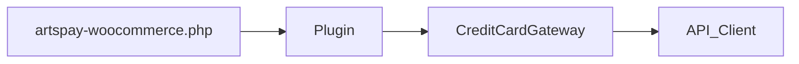

# AGENTS.md

Guidance for coding agents and contributors working in this repository.

## Project overview

**WooCommerce ArtsPay Gateway** connects a WooCommerce store to **ArtsPay** / **Fat Zebra** for card processing. The main gateway class handles inline and Direct Post card flows, subscriptions, refunds, optional **Forter** fraud screening, captcha, and (when enabled) **Google Pay** express checkout and Cart/Checkout **Blocks** mounts.

**Requirements:** PHP 8.0+, WordPress and WooCommerce per [`artspay-woocommerce.php`](artspay-woocommerce.php) headers. No Node/npm or Composer toolchain for builds (static JS/CSS only).

## Critical rules

- **Do not** edit WordPress core or WooCommerce core files.
- **Do not** commit credentials, API tokens, shared secrets, or environment files with real values.
- **Keep changes scoped** to the task; avoid drive-by refactors unrelated to the request.
- **Match existing style:** namespaced `ArtsPay\*` classes, existing patterns in [`includes/Gateways/CreditCardGateway.php`](includes/Gateways/CreditCardGateway.php), [`includes/Plugin.php`](includes/Plugin.php), [`includes/API/Client.php`](includes/API/Client.php).
- **Internationalization:** text domain `artspay`; use WordPress translation functions for user-visible strings.
- **Payment behaviour changes** should be validated on a real WooCommerce checkout (sandbox) when possible.

## Architecture

### Bootstrap

[`artspay-woocommerce.php`](artspay-woocommerce.php) defines constants (`ARTSPAY_PLUGIN_VERSION`, paths), registers a **PSR-4–style autoloader** for `ArtsPay\` → `includes/`, loads activation hooks, and boots [`ArtsPay\Plugin`](includes/Plugin.php) on `plugins_loaded`.

### Core flow

- **`Plugin`** – Registers the gateway with WooCommerce, admin hooks, text domain, optional admin asset enqueue for gateway settings CSS (and Google Pay preview when wallets are enabled).
- **`CreditCardGateway`** – Extends WooCommerce’s card gateway: settings UI, `process_payment`, subscriptions, fraud payload, captcha, wallet token handling when enabled.
- **`ArtsPay\API\Client`** – HTTP calls to Fat Zebra (purchases, refunds, wallet purchases, etc.).
- **`ArtsPay\Express\GooglePay`** / **`ArtsPay\Express\Blocks`** – Express checkout (when constructor wiring is active): classic + block mount points, asset enqueue.
- **`ArtsPay\Assets\Core`** – Shared frontend script registration and localized `ArtsPay` config.

### Notable directories

| Path | Role |
|------|------|
| `includes/Gateways/` | Payment gateway implementation |
| `includes/API/` | Fat Zebra API client |
| `includes/Express/` | Google Pay + Blocks express UI |
| `includes/Admin/` | Deferred payments admin |
| `includes/Traits/` | Encryption, utils, captcha helpers |
| `assets/js`, `assets/css` | Checkout and admin assets (no bundler) |

## Task → command matrix

| Task | Command / location |
|------|---------------------|
| PHP syntax (all files) | `./bin/check-php-syntax.sh` from the plugin root (also runs in CI) |
| Security-scoped lint | `phpcs --standard=phpcs.xml .` (WordPress escaping/nonce/SQL sniffs; also runs in CI, non-blocking) |
| Customer release ZIP (local) | `./bin/build.sh` → `releases/artspay-woocommerce-<version>.zip` (+ `.sha256`); see [`.distignore`](.distignore) |
| Customer release ZIP (published) | Push tag `v<version>` → `.github/workflows/release.yml` builds and publishes a GitHub Release automatically |
| Single file syntax | `php -l path/to/file.php` |
| Gateway settings in WP | **WooCommerce → Settings → Payments → ArtsPay** (`section=fatzebra`) |

## Common pitfalls

- **WooCommerce not loaded** – Guard with `class_exists( 'WooCommerce' )` or rely on hooks that only run when WooCommerce is active.
- **SSL** – Live wallet/express flows expect HTTPS; Apple Pay domain verification still usually needs a real HTTPS hostname even in sandbox.
- **Settings merges** – `CreditCardGateway::process_admin_options()` merges partial saves when using express sub-pages so unrelated options are not wiped; changing this risks clearing `enabled` or merchant credentials.
- **3.1.0 wallets** – Do not assume `GooglePay` or `Blocks` hooks are registered; confirm `Plugin` / gateway wiring before debugging express checkout.

## Testing

- **Manual:** Fat Zebra sandbox credentials, WooCommerce checkout, order-pay, refunds, subscriptions as applicable.
- **Automated in repo:** PHP syntax check, security-scoped PHPCS (WordPress escaping/nonce/SQL sniffs), and CodeQL — all run in CI (`.github/workflows/`) on every pull request; no PHPUnit suite yet.

## Release hygiene

- Bump **`ARTSPAY_PLUGIN_VERSION`** and the **Version** header in [`artspay-woocommerce.php`](artspay-woocommerce.php) together.
- Append **[`changelog.txt`](changelog.txt)** with a dated line: `YYYY-MM-DD - version X.Y.Z` and prefixed bullets (`* Dev -`, `* Fix -`, etc.) consistent with WooCommerce-style changelogs.
- Push a `v<version>` tag on the release commit to trigger `.github/workflows/release.yml`, which builds with `./bin/build.sh` and publishes the ZIP as a GitHub Release. To build locally without publishing, run `./bin/build.sh` directly — ships the ZIP under `releases/` (gitignored) and optionally a `.sha256` file.
- If **README** or **readme.txt** still lists a stable tag or tested-up-to line, keep it aligned with the release.
- Upgrading from a pre-3.1.0 install has real settings/behaviour changes (Test Mode merged into Sandbox Mode, Hosted Payment Page removed, Payment Title/Icon options removed) — see [`docs/MIGRATION.md`](docs/MIGRATION.md).
- Apple Pay on the Web merchant notes: [`docs/APPLE.md`](docs/APPLE.md) (shipped in customer ZIPs; internal planning docs like `docs/PLAN-*.md` are excluded via [`.distignore`](.distignore)).

## Documentation and context

- [`README.md`](README.md) – Dependencies, install, development, testing.
- [`docs/APPLE.md`](docs/APPLE.md) – Safari/HTTPS + `.well-known` hosting notes for Apple Pay on the Web.
- [`docs/MIGRATION.md`](docs/MIGRATION.md) – Settings/behaviour changes for merchants upgrading from pre-3.1.0.
- [`CONTRIBUTING.md`](CONTRIBUTING.md) – Pull requests and changelog expectations.
- [`SECURITY.md`](SECURITY.md) – Reporting vulnerabilities.

## Agent instruction maintenance

Update this file when architecture, release steps, or recurring pitfalls change (e.g. new build tooling, new directories, or wallet re-enablement).
